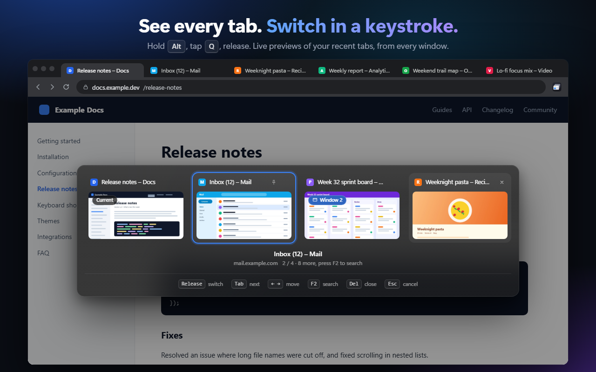
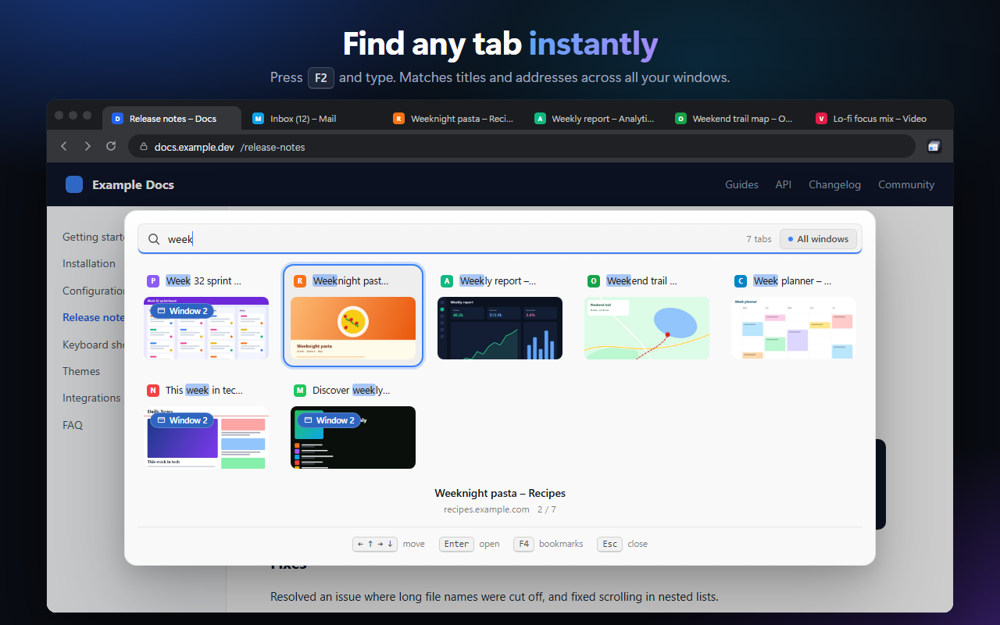
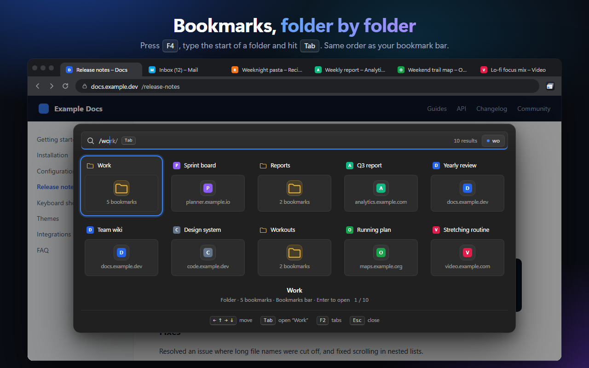

<div align="center">


# Visual Tab Switcher

**See every tab. Switch in a keystroke.**

Press <kbd>Alt</kbd>+<kbd>Q</kbd> to switch tabs with live previews, <kbd>F2</kbd> to search every open tab and <kbd>F4</kbd> to browse your bookmarks, all from the keyboard.

[**Get it on the Chrome Web Store**](https://chromewebstore.google.com/detail/visual-tab-switcher/bbigihlnllkbgknaafnndekbjekkkcgk) · [Report a bug](https://github.com/reapertakumi/Visual-Tab-Switcher/issues)



</div>

> [!NOTE]
> Visual Tab Switcher is in active development. Found a bug or have an idea? Please [open an issue](https://github.com/reapertakumi/Visual-Tab-Switcher/issues).

---

## Table of contents

- [Features](#features)
- [Screenshots](#screenshots)
- [Installation](#installation)
- [Quick start](#quick-start)
- [Keyboard and mouse reference](#keyboard-and-mouse-reference)
- [Tab search](#tab-search)
- [Bookmark search](#bookmark-search)
- [Tab previews](#tab-previews)
- [Settings](#settings)
- [Privacy](#privacy)
- [Permissions](#permissions)
- [Known limitations](#known-limitations)
- [Troubleshooting](#troubleshooting)
- [Browser support](#browser-support)
- [Project structure](#project-structure)
- [Development](#development)
- [Changelog](#changelog)
- [Roadmap](#roadmap)
- [Contributing](#contributing)

---

## Features

### Switch tabs visually: <kbd>Alt</kbd>+<kbd>Q</kbd>

- **Live previews** of your most recently used tabs, newest first.
- **Every window at once.** Tabs from other windows are mixed into the same recent-first list and marked with a **Window 2** badge, so you always know where a tab lives. Switching to one brings its window to the front.
- **Hold, tap, release.** Hold <kbd>Alt</kbd>, tap <kbd>Q</kbd> to move, let go of <kbd>Alt</kbd> to switch. A quick tap of <kbd>Alt</kbd>+<kbd>Q</kbd> jumps straight back to your previous tab.
- **The mouse never steals the selection.** Hovering a card only brightens it and reveals its ✕. Only the keyboard moves the selection.
- **Close without leaving.** Click ✕, middle-click a card, or press <kbd>Delete</kbd>.
- **Sized for your screen.** Cards keep a fixed size and the switcher shows exactly as many as fit, in one, two or three rows. Nothing is ever cut off.

### Find any tab instantly: <kbd>F2</kbd>

- Type a few letters: every word is matched against tab **titles and addresses**, with matches highlighted.
- On any page, <kbd>F2</kbd> searches **all windows**. From inside the <kbd>Alt</kbd>+<kbd>Q</kbd> switcher, it searches **just the current window**.
- Results fill your screen in a grid and scroll for more.

### Bookmarks, folder by folder: <kbd>F4</kbd>

- Shows your bookmarks **in the same order as your bookmark bar**.
- **Folders are cards** with their bookmark count. Press <kbd>Enter</kbd> to open one.
- **Tab completion for folders:** type `/wo`, press <kbd>Tab</kbd> and it becomes `/Work/`.
- **Search inside a folder:** `/Work/report`.

### Make it yours

- Light, dark or system theme, and nine accent colors.
- **Translucent panel** (frosted glass) with adjustable opacity.
- Background dim, corner style, card size, title position and optional keyboard hints.
- **Live preview** of every style change in Settings.
- A **guided setup** on first install that lets you try everything right on the page.

### Fast and private

- No build step, no frameworks, no remote code.
- Pages only get a tiny keyboard listener; the switcher is built only when you open it.
- Previews are small thumbnails stored **only on your computer**. No accounts, no analytics, no tracking.

---

## Screenshots

| Switch tabs (<kbd>Alt</kbd>+<kbd>Q</kbd>) | Search tabs (<kbd>F2</kbd>) | Search bookmarks (<kbd>F4</kbd>) |
| :---: | :---: | :---: |
|  |  |  |

---

## Installation

### From the store

| Store | Link |
| --- | --- |
| Chrome Web Store | [Visual Tab Switcher](https://chromewebstore.google.com/detail/visual-tab-switcher/bbigihlnllkbgknaafnndekbjekkkcgk) |
| Microsoft Edge Add-ons | Coming soon. Until then, Edge can install it from the Chrome Web Store (allow extensions from other stores when Edge asks). |

After installing, a short setup opens: try <kbd>Alt</kbd>+<kbd>Q</kbd>, <kbd>F2</kbd> and <kbd>F4</kbd> right on the page, pick your theme, accent color and layout, and capture all tab previews. Run it again anytime from Settings → *Run setup again*.

### Install from source (developer mode)

1. Download or clone this repository:
   ```bash
   git clone https://github.com/reapertakumi/Visual-Tab-Switcher.git
   ```
2. Open `chrome://extensions` (Edge: `edge://extensions`).
3. Turn on **Developer mode** (top right).
4. Click **Load unpacked** and select the `Visual-Tab-Switcher` folder.
5. The setup opens automatically. Follow it, or skip it.

> [!TIP]
> Pages that were already open before installing work right away: the extension adds itself to them automatically.

---

## Quick start

1. **Hold** <kbd>Alt</kbd> and **tap** <kbd>Q</kbd>. The switcher opens with your recent tabs.
2. Keep holding <kbd>Alt</kbd> and tap <kbd>Q</kbd> again to move to the next tab.
3. **Let go** of <kbd>Alt</kbd> to switch.

That's it. Press <kbd>F2</kbd> to search your tabs and <kbd>F4</kbd> to search your bookmarks.

> [!IMPORTANT]
> While you're holding <kbd>Alt</kbd>, press <kbd>Q</kbd> (not <kbd>Tab</kbd>) to move: <kbd>Alt</kbd>+<kbd>Tab</kbd> is taken by Windows itself. Once you release <kbd>Alt</kbd>, <kbd>Tab</kbd> works too.

---

## Keyboard and mouse reference

### Browser shortcuts

These work everywhere and can be changed at `chrome://extensions/shortcuts`.

| Shortcut | Action | Default |
| --- | --- | --- |
| Open the switcher / next tab | Opens the switcher, or moves forward if it's already open | <kbd>Alt</kbd>+<kbd>Q</kbd> |
| Previous tab | Opens the switcher, or moves backward | <kbd>Alt</kbd>+<kbd>Shift</kbd>+<kbd>Q</kbd> |
| Search tabs in all windows | Global version of <kbd>F2</kbd>, also works while the address bar has focus | *not set* |
| Search bookmarks | Global version of <kbd>F4</kbd> | *not set* |

### Page hotkeys

Work on any web page while the switcher is closed. Configurable in Settings (<kbd>F1</kbd> to <kbd>F12</kbd>).

| Key | Action |
| --- | --- |
| <kbd>F2</kbd> | Search tabs in all windows |
| <kbd>F4</kbd> | Search bookmarks |

### Inside the switcher

| Key | Action |
| --- | --- |
| Release <kbd>Alt</kbd> | Switch to the selected tab |
| <kbd>Q</kbd> (while holding <kbd>Alt</kbd>) | Next tab |
| <kbd>Tab</kbd> / <kbd>Shift</kbd>+<kbd>Tab</kbd> | Next / previous tab (after releasing <kbd>Alt</kbd>) |
| <kbd>←</kbd> <kbd>→</kbd> | Move left / right |
| <kbd>↑</kbd> <kbd>↓</kbd> | Move between rows (2- and 3-row layouts, search and bookmark grids) |
| <kbd>Home</kbd> / <kbd>End</kbd> | First / last tab |
| <kbd>PageUp</kbd> / <kbd>PageDown</kbd> | One screen up / down in grids |
| <kbd>Enter</kbd> | Switch to the selected tab, or open the selected bookmark or folder |
| <kbd>Delete</kbd> | Close the selected tab |
| <kbd>F2</kbd> | Search tabs in this window (works while still holding <kbd>Alt</kbd>) |
| <kbd>F4</kbd> | Switch to bookmark search |
| Any letter | Start searching (once <kbd>Alt</kbd> is released) |
| <kbd>Esc</kbd> | Back to the switcher from search, or close |

### Mouse

| Action | Result |
| --- | --- |
| Hover a card | Brightens it and shows its ✕ (the selection doesn't move) |
| Click a card | Switch to that tab |
| Click ✕ or middle-click a card | Close that tab |
| Mouse wheel | Scroll the row or grid |
| Click outside the panel | Close the switcher |

---

## Tab search

- Every word you type must appear in the tab's **title or address** (`git pull` finds *"Pull requests · my-repo"* on `github.com`).
- Results are ranked: titles that **start** with your words come first, then matches at the start of a word, then anywhere in the title, then address-only matches. Equal matches keep recent-first order.
- **Scope:** <kbd>F2</kbd> on a page searches **all windows**. <kbd>F2</kbd> from the <kbd>Alt</kbd>+<kbd>Q</kbd> switcher searches **this window**. The label in the search box always says which.

---

## Bookmark search

With an empty search, <kbd>F4</kbd> shows your bookmark bar **in its own order**, followed by *Other bookmarks* and *Mobile bookmarks*, just like the bar itself.

### Query syntax

| You type | You get |
| --- | --- |
| `recipes` | Bookmarks and folders whose name or address contains "recipes" |
| `/Work/` | The contents of the **Work** folder, in bookmark order |
| `/Work/report` | "report" anywhere inside **Work** (and its subfolders) |
| `/Work/Reports/` | A subfolder: folders are matched in order |
| `/wo` + <kbd>Tab</kbd> | Completes the folder name to `/Work/` |
| `/Work report` | Same as `/Work/report` (older syntax, still supported) |

- Typing the start of a folder name shows the rest in grey. <kbd>Tab</kbd> (or <kbd>Enter</kbd> after a `/`) completes it.
- Folder names match **exactly** once a folder with that exact name exists (`/Work/` doesn't include *Workouts*), and **partially** while you're still typing (`/wo` finds *Work*).
- Selecting a folder card and pressing <kbd>Enter</kbd> opens it.
- Bookmarklets (`javascript:` bookmarks) are not shown, because they can't be opened from an extension.

---

## Tab previews

Browsers only let extensions take a screenshot of the tab that's **visible right now**. Visual Tab Switcher captures previews:

- shortly after you switch to a tab,
- when a page finishes loading or changes its address (for example in single-page apps),
- when you come back to a window,
- the moment you press <kbd>Alt</kbd>, so the tab you're leaving is up to date.

Each preview is a small JPEG kept in the extension's local storage (up to 200, about 5 MB in total). When you come back to a tab, its preview is retaken only if it's older than your **Refresh previews** setting (10 seconds, 30 seconds or 1 minute) or the page's address changed.

> [!TIP]
> **Settings → Capture all previews now** quickly shows each open tab once to take its picture, then puts everything back exactly as it was: the same tab in front in every window, the same focused window, the same recent-tabs order, and unloaded tabs are unloaded again. Press any switcher shortcut to stop it.

Tabs without a preview show their site icon instead.

---

## Settings

Open Settings by clicking the extension's icon in the toolbar. Every change is saved immediately, and the setup can be re-run from **Run setup again**.

### Style

| Setting | Options | Default |
| --- | --- | --- |
| Theme | System, Light, Dark | System |
| Accent color | Blue, Windows blue, Purple, Pink, Red, Orange, Green, Teal, White | Blue |
| Show keyboard hints | On / Off | On |
| Tab title position | Above preview, Below preview | Above |
| Translucent panel | On / Off | Off |
| Panel opacity | 30 to 100% (when translucent) | 75% |
| Background dim | None, Light, Medium, Strong | Medium |
| Corner style | Square, Rounded, Extra round | Rounded |
| Animations | On / Off. Off: the switcher appears instantly with no fade, hover effect or smooth scrolling | On |

### Display

| Setting | Options | Default |
| --- | --- | --- |
| Tabs in the switcher | **Auto** (one row, as many as fit), **Auto · 2 rows**, **Auto · 3 rows**, or at most 4 / 6 / 8 / 10 / 12 | Auto |
| Show previews | On / Off | On |
| Refresh previews | Every 10 seconds, 30 seconds or minute | 30 seconds |
| Card size | 70 to 150% | 100% |
| Hide internal pages | Hides `chrome://`, `edge://`, `brave://`, `about:` and similar pages | Off |

### Tab Search and Bookmark Search

| Setting | Options | Default |
| --- | --- | --- |
| Search hotkey | <kbd>F1</kbd> to <kbd>F12</kbd> | <kbd>F2</kbd> |
| Use the search hotkey on web pages | On / Off | On |
| Bookmark hotkey | <kbd>F1</kbd> to <kbd>F12</kbd> | <kbd>F4</kbd> |
| Use the bookmark hotkey on web pages | On / Off | On |

Settings are stored with `chrome.storage.sync`, so they follow you to other computers where you're signed in to the browser.

### Reset

**Reset extension** (at the bottom of the Tab Switcher page) puts everything back the way it was on first install: all settings return to their defaults, saved previews are deleted and the setup opens again. It asks for confirmation first. Keyboard shortcuts are kept, because browsers don't let extensions change them; reset those at `chrome://extensions/shortcuts`.

---

## Privacy

- **No data leaves your browser.** There are no servers, accounts, analytics or ads.
- Tab previews are stored only in the extension's local storage on your computer, and deleted when the tab is closed.
- The extension never reads the content of web pages. It only draws the switcher on top of them and screenshots the visible tab for previews.
- Bookmarks are read-only: the extension never changes them.

---

## Permissions

| Permission | Why it's needed |
| --- | --- |
| `tabs` | Read tab titles, addresses and icons to list, switch to and close tabs |
| `scripting` | Add the switcher to pages that were already open when the extension was installed or updated |
| `storage` | Save your settings, the recent-tabs order and the preview thumbnails locally |
| `bookmarks` | Read your bookmarks for bookmark search (read-only) |
| `favicon` | Show site icons on bookmark and tab cards |
| Access to all sites | Draw the switcher on the page you're viewing and capture the visible tab as a preview |

---

## Known limitations

- **Browser pages can't show the switcher.** Chrome doesn't let extensions run on `chrome://` pages, the new-tab page or the Web Store. There, <kbd>Alt</kbd>+<kbd>Q</kbd> jumps straight to your previous tab instead, and <kbd>F2</kbd> / <kbd>F4</kbd> only work if you've set the optional global shortcuts.
- **Unvisited tabs have no preview** until you open them once (or use *Capture all previews now*).
- **Covered or minimized windows aren't captured**, because the browser doesn't draw them, so their screenshots would come out blank.
- **Alt+Tab is reserved by Windows**, so while holding <kbd>Alt</kbd>, use <kbd>Q</kbd> to move.
- **Private browsing:** incognito tabs only appear when the extension is allowed in incognito, and are never mixed with regular tabs.

---

## Troubleshooting

<details>
<summary><b>Alt+Q does nothing</b></summary>

Another extension may already use <kbd>Alt</kbd>+<kbd>Q</kbd>, in which case Chrome doesn't assign it. Open `chrome://extensions/shortcuts` (or Settings → *Change shortcuts*) and set *Open the switcher / next tab* to a free combination. The setup screen also warns you when no shortcut is set.
</details>

<details>
<summary><b>Alt+Shift+Q isn't set after updating</b></summary>

Browsers don't always assign default shortcuts for commands added in an update. Set *Previous tab* at `chrome://extensions/shortcuts`.
</details>

<details>
<summary><b>The switcher doesn't appear on the current page</b></summary>

It can't be drawn on browser pages (`chrome://…`, the new-tab page, the Web Store). On a normal page that was open before you installed or reloaded the extension, reload the page once.
</details>

<details>
<summary><b>Some tabs have no preview</b></summary>

Previews are taken when a tab is on screen. Visit the tab once, or use Settings → *Capture all previews now*. Browser pages can never be captured.
</details>

<details>
<summary><b>F2 / F4 conflict with a website</b></summary>

Pick different keys in Settings, or turn off *Use the hotkey on web pages* and set the optional global shortcuts at `chrome://extensions/shortcuts` instead.
</details>

<details>
<summary><b>How do I see the setup again?</b></summary>

Settings → *Run setup again*. To also start over with default settings, use Settings → *Reset extension*.
</details>

---

## Browser support

Works in Google Chrome and other Chromium-based browsers (Microsoft Edge, Brave, Vivaldi, Opera), in a **recent version (Chrome 116 or newer)**.

---

## Project structure

```text
Visual-Tab-Switcher/
├── manifest.json        Extension manifest (Manifest V3)
├── background.js        Service worker: recent-tabs order, preview capture, shortcuts, messaging
├── content.js           Tiny loader on every page: modifier keys, F2/F4, messages (~7 KB)
├── ui.js                The switcher, search and bookmark UI, loaded on demand (closed shadow DOM, styles inlined)
├── settings.html / .js  Settings page with live style preview
├── welcome.html / .js   Guided first-time setup (also shown once after updating from 0.1)
├── icons/               Extension icons (16, 48, 128 px)
└── store-assets/        Store screenshots, promo tiles and listing text
```

### How it works

- **`background.js`** keeps the most-recently-used tab order (in `chrome.storage.session`), captures preview thumbnails, scales them down to 480 px wide and stores each one under its own key in `chrome.storage.local`. A capture queue keeps within Chrome's limit of two screenshots per second, and every capture is checked so it's never saved under the wrong tab.
- **`content.js`** is a ~7 KB loader that runs on every page. It only tracks the modifier keys, catches <kbd>F2</kbd> / <kbd>F4</kbd> and answers the background. Settings are read once the page is idle, and it only listens for settings changes, never for preview writes.
- **`ui.js`** holds the actual switcher. It's imported the first time it's needed, or as soon as <kbd>Alt</kbd> is pressed so it's ready before <kbd>Q</kbd>. The overlay is built inside a **closed shadow root**, so page styles and scripts can't affect it. It opens with titles only and then requests previews for the cards on screen; those are freed 30 seconds after it closes.
- The extension's own pages (Settings and setup) load `content.js` directly, so the shortcuts work there too.

---

## Development

There's no build step: the folder is the extension.

1. [Load it unpacked](#install-from-source-developer-mode).
2. After changing code, click **Reload** on the extension in `chrome://extensions`, then reload the pages you're testing on.
3. Debugging:
   - **Background:** `chrome://extensions` → *Service worker* → *Inspect*.
   - **Switcher:** the page's own DevTools (the overlay lives in a closed shadow root under `<vts-switcher-root>`).
   - **Settings / setup:** right-click the page → *Inspect*.

> [!NOTE]
> The setup opens automatically only on a fresh install, or once for people updating from version 0.1. Reloading an unpacked extension doesn't show it: use Settings → *Run setup again*.

---

## Changelog

The full history is in **[CHANGELOG.md](CHANGELOG.md)**.

**0.2.0** is a complete rewrite:
- a Windows 11-inspired design,
- recent tabs from all windows, and hover that never moves the selection,
- grid search and bookmark folders with <kbd>Tab</kbd> completion,
- much more reliable previews, with *Capture all*,
- style options with a live preview,
- a guided setup.

---

## Roadmap

Ideas being considered:

- Tab group colors and names on cards
- A *Recently closed* row to reopen tabs
- Number keys <kbd>1</kbd> to <kbd>9</kbd> to jump straight to a card
- Pin and mute tabs from the switcher
- Move a tab from another window into the current one
- Typo-tolerant search and browsing history search

Have an idea? [Open an issue](https://github.com/reapertakumi/Visual-Tab-Switcher/issues).

---

## Contributing

Bug reports and suggestions are very welcome. When reporting a bug, please include:

- your browser and its version,
- what you did, what you expected and what happened,
- any errors from the service worker console (`chrome://extensions` → *Service worker* → *Inspect*).
